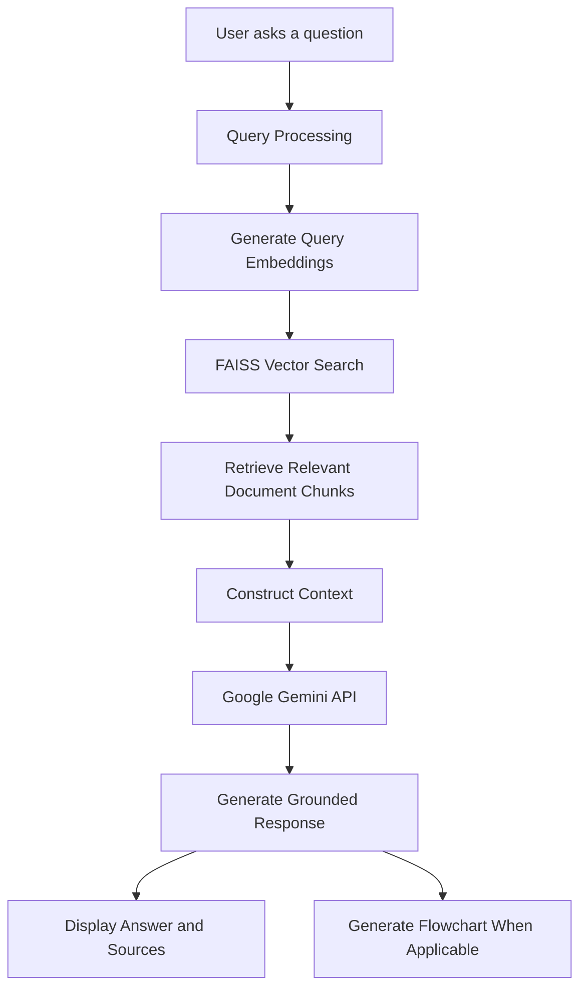

# 🩺 MediFlow AI Assistant
### Your Intelligent Guide to the MediFlow Appointment & Queue Management Platform

<p align="center">
  <a href="https://mediflow-rag-assistant.streamlit.app/"><strong>🚀 LIVE DEMO</strong></a> •
  <a href="https://github.com/syneadityaa/MediFlow-RAG-Assistant"><strong>💻 GITHUB REPOSITORY</strong></a>
</p>

<p align="center">
  
  
  
  
  
</p>

---

## 🌟 Overview

**MediFlow AI Assistant** is an intelligent, document-grounded chatbot built to help users understand and navigate the MediFlow Smart Medical Appointment & Queue Optimization System.

Powered by **Retrieval-Augmented Generation (RAG)** and Google's Gemini API, the assistant retrieves relevant information from project documentation and uses it to generate natural, context-aware responses.

Instead of relying entirely on general-purpose AI knowledge, it uses a dedicated MediFlow knowledge base to answer questions about platform features, workflows, and functionality.

The assistant also generates visual flowcharts to make complex processes easier to understand.

<p align="center">
  <strong>Ask questions. Understand workflows. Explore MediFlow.</strong>
</p>

## 🚀 Live Application

**Try it here:** https://mediflow-rag-assistant.streamlit.app/

The application is deployed and accessible through Streamlit Community Cloud.

## ✨ Key Features

| Feature | Description |
|---|---|
| 🧠 RAG-Based Question Answering | Retrieves relevant project information before generating responses. |
| 💬 Natural Conversations | Handles greetings, casual interactions, and contextual questions. |
| 📚 Knowledge-Grounded Responses | Uses MediFlow project documentation as its information source. |
| 📊 Flowchart Generation | Converts supported workflows into visual step-by-step flowcharts. |
| 🔍 Document Retrieval | Uses semantic embeddings and vector similarity search to find relevant information. |
| 🛡️ Safety-Aware Responses | Avoids providing medical diagnosis or treatment advice. |
| 🎨 Interactive Interface | Provides a clean, conversational Streamlit interface. |

## 🏗️ How It Works

The assistant follows a Retrieval-Augmented Generation pipeline.



### RAG Pipeline Explained

1. **Document Loading:** MediFlow documentation is loaded from the knowledge base.
2. **Text Chunking:** Documents are divided into smaller, manageable text chunks.
3. **Embedding Generation:** Sentence Transformers converts text into numerical vector representations.
4. **Vector Storage:** FAISS stores and indexes embeddings for efficient similarity search.
5. **Retrieval:** When a user asks a question, relevant document chunks are retrieved.
6. **Contextual Generation:** Retrieved information is passed to Google Gemini to generate a natural-language answer.
7. **Response Presentation:** The application displays the answer, relevant sources, and flowcharts where applicable.

## 🛠️ Technology Stack

| Technology | Purpose |
|---|---|
| Python | Core application and RAG pipeline |
| Streamlit | Interactive chatbot interface |
| Google Gemini API | Large Language Model for response generation |
| Sentence Transformers | Text embedding generation |
| FAISS | Vector indexing and similarity search |
| NumPy | Numerical operations |
| PyPDF | PDF document processing |
| Python Dotenv | Environment variable management |

## 📂 Project Structure

```text
MediFlow-RAG-Assistant/
│
├── app.py
│
├── src/
│   ├── rag_pipeline.py
│   ├── embeddings.py
│   ├── vector_store.py
│   ├── document_loader.py
│   └── text_chunker.py
│
├── knowledge_base/
│   └── MediFlow project documents
│
├── requirements.txt
├── .env.example
├── .gitignore
└── README.md
```

## ⚙️ Run Locally

Follow these steps to run the application on your machine.

### 1. Clone the repository

```bash
git clone https://github.com/syneadityaa/MediFlow-RAG-Assistant.git
```

### 2. Navigate to the project directory

```bash
cd MediFlow-RAG-Assistant
```

### 3. Create a virtual environment

```bash
python3 -m venv .venv
```

Activate it:

**macOS / Linux**
```bash
source .venv/bin/activate
```

**Windows**
```bash
.venv\Scripts\activate
```

### 4. Install dependencies

```bash
pip install -r requirements.txt
```

### 5. Configure environment variables

Create a `.env` file in the project root:

```env
GEMINI_API_KEY=your_gemini_api_key
```

Obtain your API key from [Google AI Studio](https://aistudio.google.com/).

Never upload your actual API key or `.env` file to GitHub.

### 6. Launch the application

```bash
streamlit run app.py
```

The application will open in your browser.

## 💡 Example Questions

Try asking the assistant:

- How do I register on MediFlow?
- How can a patient search for doctors?
- Explain the appointment booking process.
- How does the queue management system work?
- What can doctors do through their dashboard?
- How does appointment cancellation work?

The assistant can also present supported workflows as visual flowcharts.

## 🛡️ Responsible AI & Limitations

MediFlow AI Assistant is designed specifically for explaining the MediFlow software platform.

- Responses are grounded in the available project documentation.
- The assistant may not answer questions that are outside its knowledge base.
- It does not provide medical diagnoses, prescriptions, or treatment recommendations.
- Generated responses should not be treated as a replacement for official platform documentation.

## ☁️ Deployment

The application is deployed using **Streamlit Community Cloud**.

- **Live Application:** https://mediflow-rag-assistant.streamlit.app/
- **Source Code:** https://github.com/syneadityaa/MediFlow-RAG-Assistant

The Gemini API key is configured through Streamlit Secrets rather than being stored in the public repository.

## 🔮 Future Enhancements

Potential areas for future development:

- Integration with the main MediFlow application.
- More advanced conversational memory and contextual retrieval.
- Improved document management and knowledge-base updates.
- Enhanced retrieval accuracy and response evaluation.
- Additional interactive workflow visualizations.

## 👨‍💻 Author

**Aditya Raj**

B.Tech – Computer Science & Artificial Intelligence and Machine Learning

GitHub: [@syneadityaa](https://github.com/syneadityaa)

---

<p align="center">
  <strong>Built with Python, RAG, and Google Gemini ❤️</strong>
  <br/>
  <em>Making MediFlow easier to understand, one question at a time.</em>
</p>
